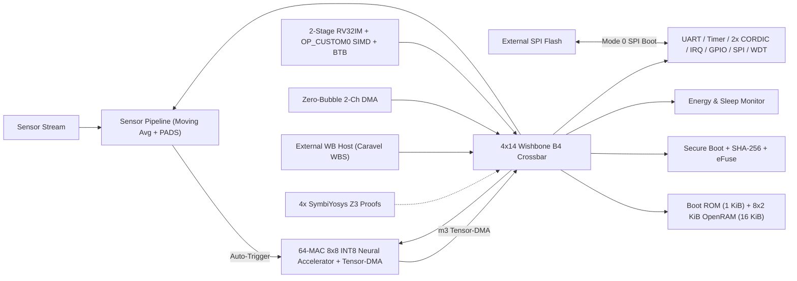

# ORX-1

## High-Throughput Edge-AI SoC Reference Design (2-Stage RV32IM + `OP_CUSTOM0` SIMD + 64-MAC Tensor-DMA NPU + Caravel Sky130 Floorplan)

ORX-1 is an open SystemVerilog Edge-AI SoC integrating a **2-stage pipelined RV32IM core** (8-entry BTB, 16-cycle Radix-4 divider, posted-store LSU overlap, and single-cycle **`OP_CUSTOM0` INT8 SIMD** instructions), a **64-MAC `8x8` INT8 neural accelerator with autonomous Tensor-DMA (`121.5 MOPS` @ 50 MHz)**, an autonomous sensor-to-NPU PADS streaming pipeline, **`16 KiB` dual-port SRAM** backed by **8x `2 KiB` OpenRAM macros** (`sky130_sram_2kbyte_1rw1r_32x512_8`), a multi-block SHA-256 / FNV-1a secure-boot engine with hardware SPI flash bootloader, a **4-master x 14-slave Wishbone B4 crossbar**, a 2-channel zero-bubble Micro-DMA and 2x/cycle unrolled CORDIC engine, **4 Z3 formal proofs**, and a verified **100 MHz Caravel SkyWater 130nm physical floorplan**.

All checks execute locally and in CI with zero warnings under strict Verilator (`-Wall`), Yosys synthesis elaboration (`-DUSE_OPENRAM -DSYNTHESIS`), C host TinyML tests, 12 Icarus Verilog simulations (including `-D USE_OPENRAM` synchronous SRAM runs), automated floorplan DRC/channel/PDN checks, and 4 SymbiYosys + Z3 formal proofs. Physical PDK placement/routing, post-CTS 100 MHz timing closure, and silicon power characterization require running the downstream OpenLane 2 flow with `sky130A`.

> ORX-1 bridges cycle-accurate Edge-AI SoC design, custom RISC-V SIMD + Tensor-DMA acceleration, formal interface proofs, and Caravel OpenRAM physical floorplanning in a compact, zero-comment codebase.

## Repository status

| Area | Current state | Scope of the implementation |
|---|---|---|
| Control core (`rv32i_core`) | Implemented | 2-stage IF/EX RV32IM pipeline, 8-entry direct-mapped BTB, non-blocking posted stores, 16-cycle Radix-4 `DIV*`/`REM*`, `OP_CUSTOM0` INT8 SIMD (`ORX.DOT4`, `ORX.CLIP8`, `ORX.PACK4`), machine CSRs (`mstatus`, `misa`, `mie`, `mtvec`, `mepc`, `mcause`, `mip`, `mhartid`, 64-bit `mcycle*`/`minstret*`), `WFI`, `MRET`, synchronous traps |
| On-chip memory (`boot_rom`, `sram_sp`) | Implemented | `1 KiB` boot ROM window (`0x00000000`–`0x000003FF`, `BUILTIN_BOOTLOADER` or `BOOT_HEX`) + **`16 KiB` dual-port SRAM** (`0x00010000`–`0x00013FFF`, synthesized/simulated as `8` x `2 KiB` `sky130_sram_2kbyte_1rw1r_32x512_8` OpenRAM macros under `USE_OPENRAM`) |
| Interconnect (`wb_interconnect`) | Implemented | **4-master** (`m0` CPU, `m1` Micro-DMA, `m2` external WB host, `m3` NPU Tensor-DMA) x 14-slave round-robin Wishbone B4 crossbar |
| Sensor pipeline (`sensor_pipeline`) | Implemented | Depth 1/2/4 moving average + Predictive Adaptive Delta-Stream (PADS), thresholds, direct auto-inference trigger |
| Neural accelerator (`neural_accel`) | Implemented | **64-MAC `8x8` INT8 array**, hardware `cfg_accum`, bias, shift, ReLU, INT8 clamp, packed `4x INT8` outputs, 2:4 sparsity, 4x4 shadow weights, threshold IRQ filter, and **autonomous weight-stationary Tensor-DMA** (`wb` Master 3) |
| Secure boot (`secure_boot`, `sha256_engine`) | Implemented | Multi-block SHA-256 and FNV-1a verification over boot ROM (`1..256` words) or SRAM (`1..2048` words), lockable 256-bit eFuse words, full digest readback (`0x18`), explicit `boot_release`/`fail` states |
| Peripherals | Implemented | 8-byte FIFO 8-N-1 UART, 64-bit `mtime`/`mtimecmp`, zero-bubble 2-ch Micro-DMA, **2x/cycle CORDIC (8-cycle mag/rot)**, 6-source IRQ controller, 16-pin GPIO, SPI master, System Control / WDT |
| Energy accounting (`energy_monitor`) | Implemented | Cycle, sensor, accelerator, data-bus, CPU performance, active/sleep cycle, and weighted activity counters |
| Formal checks (`formal/`) | Verified | 4 SymbiYosys + Z3 jobs (`cpu_bus.sby`, `wb_xbar.sby`, `neural_accel.sby`, `secure_boot.sby`) + SVA bind (`interface_sva.sv`) |
| Bare-metal C & TinyML SDK (`sw/`) | Implemented | HAL CSR macros + `orx_dot4`/`orx_clip8`/`orx_pack4` intrinsics ([`orx1.h`](sw/include/orx1.h)), `tinyml_dense_8x8_ex` + `tinyml_dense_tdma` ([`tinyml.c`](sw/tinyml/tinyml.c)), SPI flash bootloader (`bootloader.c`), host regression & multi-layer benchmark |
| Physical floorplan (`openlane/`, `docs/floorplan.md`) | Verified geometry | Hierarchical OpenLane 2 configs targeting **100 MHz (`10.0 ns`)** on Caravel (`2920 x 3520 um`, `u_soc` `2720 x 3320 um`), symmetric 8-bank OpenRAM H-tree (`macro.cfg`), PDN hooks, automated DRC/overlap/channel validator ([`floorplan_analyze.py`](scripts/floorplan_analyze.py)), blueprint PNG; PDK DRC/LVS/GDS requires local OpenLane 2 + `sky130A` |

## Architecture



1. **2-Stage Pipelined RV32IM + Custom INT8 SIMD**: [`rtl/rv32i_core.sv`](rtl/rv32i_core.sv) overlaps instruction fetch with execution using an 8-entry BTB, single-cycle non-blocking posted stores, a 16-cycle Radix-4 integer divider, and `OP_CUSTOM0` vector intrinsics (`ORX.DOT4`, `ORX.CLIP8`, `ORX.PACK4`) delivering a **4.55x speedup** on CPU-only `4x4` quantized INT8 inference (`66` vs `300` cycles).
2. **64-MAC `8x8` NPU + Autonomous Weight-Stationary Tensor-DMA**: [`rtl/neural_accel.sv`](rtl/neural_accel.sv) scales the datapath to 64 signed INT8 MACs/cycle (`8x8` wide mode) and adds a dedicated Wishbone Master (`m3`) that autonomously streams activations, weights, and biases from SRAM and writes packed clamped INT8 outputs directly back to SRAM—accelerating a 4-sample `8->4->4` MLP from `691` polled cycles to **`158` cycles (`121.5 MOPS` @ 50 MHz, `4.37x` faster than polled MMIO)**.
3. **Zero-CPU Autonomous Sensing (`WFI` Wake-on-Anomaly)**: [`rtl/sensor_pipeline.sv`](rtl/sensor_pipeline.sv) streams PADS/averaged samples into `neural_accel` while `rv32i_core` sleeps in `WFI` (`core_sleep = 1`), waking only once when an anomaly exceeds `anomaly_thresh`.
4. **Physical Caravel OpenRAM Floorplan**: Detailed in [`docs/floorplan.md`](docs/floorplan.md), arranging eight modeled `2 KiB` OpenRAM macros (`683.1 x 416.5 um` each) in a symmetric H-tree around a `1153.8 um` central compute spine inside the `2720 x 3320 um` hardened `orx1_soc` macro.

## Memory map

| Slave | Region | Base address | Size | Function |
|---:|---|---:|---:|---|
| 0 | Boot ROM window | `0x00000000` | `0x400` | Read-only boot window (host-writable over WB Master 2; `BUILTIN_BOOTLOADER` or `BOOT_HEX`) |
| 1 | SRAM (`sram_sp`) | `0x00010000` | `0x4000` | `16 KiB` single/dual-port data and executable instruction memory (`8 x 2 KiB` OpenRAM banks) |
| 2 | Sensor pipeline | `0x40000000` | `0x100` | Sample inject, filter depth (`0..3` incl. PADS), thresholds, auto-infer enable |
| 3 | Neural accelerator | `0x40001000` | `0x100` | `8x8` INT8 operands, shift/bias/ReLU/clamp/accum/sparse/shadow/packed + Tensor-DMA CSRs (`0x70..0xE0`) |
| 4 | Secure boot | `0x40002000` | `0x100` | Multi-block SHA-256 / FNV-1a verification over ROM/SRAM (`0x18` exposes full 256-bit digest) and lockable eFuse words |
| 5 | UART core | `0x40003000` | `0x100` | Full-duplex 8-N-1 UART with 8-byte TX/RX FIFOs and IRQ masks |
| 6 | Energy monitor | `0x40004000` | `0x100` | Total/active/`WFI`-sleep cycles, CPU perf counters, and weighted activity proxy |
| 7 | System Timer | `0x40005000` | `0x100` | RISC-V 64-bit real-time counter (`mtime` / `mtimecmp`) |
| 8 | Micro-DMA | `0x40006000` | `0x100` | Zero-bubble 2-channel autonomous DMA (`auto-restart`, `src_fixed`/`dst_fixed`) |
| 9 | CORDIC coprocessor | `0x40007000` | `0x100` | 2x/cycle unrolled 16-step vectoring magnitude and rotation engine |
| 10 | Interrupt controller | `0x40008000` | `0x100` | 6-source maskable peripheral IRQ aggregator (`sensor`, `accel`, `alert/gpio`, `uart`, `dma`, `cordic/spi`) |
| 11 | GPIO controller | `0x40009000` | `0x100` | 16-pin bidirectional GPIO with rising-edge interrupts |
| 12 | SPI master | `0x4000A000` | `0x100` | Configurable SPI Mode 0–3 master (`8`/`32`-bit transfers) |
| 13 | System control / WDT | `0x4000B000` | `0x100` | Host CPU boot-hold/boot-gate control, hardware watchdog timer, and sticky WB host error flag (`bit 3`) |

Complete register definitions, custom SIMD encodings, and bus rules are documented in [`docs/register_map.md`](docs/register_map.md) and [`docs/bus.md`](docs/bus.md).

## Model & speed benchmarks

### Hardware RTL simulation (`tb/tb_model_bench.sv` @ 50 MHz)

[`tb/tb_model_bench.sv`](tb/tb_model_bench.sv) boots into SRAM (`0x00011000`, `413/3072` words), verifies every quantized output against golden references, and logs cycle, instruction, sleep, and `energy_monitor` counters (`MODEL_BENCH_PASS total_cycles=2036`, [`build/model_benchmark.csv`](build/model_benchmark.csv)):

| Workload | Cycles | Instr | CPI | Latency @ 50MHz | Throughput (`inf/s`) | MACs | MAC/cyc | MOPS @ 50MHz | Accel Events | Sleep Cyc | Wakeups | Weighted Energy |
|---|---:|---:|---:|---:|---:|---:|---:|---:|---:|---:|---:|---:|
| `cpu_mlp_4x4` | 300 | 207 | 1.45 | 6.00 us | 166,667 | 16 | 0.05 | 5.3 | 0 | 0 | 0 | 500 |
| `cpu_simd_4x4` | 66 | 41 | 1.61 | 1.32 us | 757,576 | 16 | 0.24 | 24.2 | 0 | 0 | 0 | 146 |
| `npu_mlp_4x4` | 82 | 49 | 1.67 | 1.64 us | 609,756 | 16 | 0.20 | 19.5 | 1 | 0 | 0 | 250 |
| `npu_wide_8x8` | 144 | 79 | 1.82 | 2.88 us | 347,222 | 64 | 0.44 | 44.4 | 1 | 0 | 0 | 432 |
| `npu_mlp_8x4x4_x4` | 691 | 426 | 1.62 | 13.82 us | 72,359 | 192 | 0.28 | 27.8 | 12 | 0 | 0 | 1931 |
| **`npu_tdma_mlp_x4`** | **158** | **111** | **1.42** | **3.16 us** | **316,456** | **192** | **1.22** | **121.5** | **2** | **0** | **0** | **518** |
| `npu_sparse_2_4` | 81 | 48 | 1.69 | 1.62 us | 617,284 | 8 | 0.10 | 9.9 | 1 | 0 | 0 | 249 |
| `dma_burst_16w` | 96 | 69 | 1.39 | 1.92 us | 520,833 | — | 0.00 | 0.0 | 0 | 0 | 0 | 344 |
| `cordic_vec_mag` | 44 | 31 | 1.42 | 0.88 us | 1,136,364 | — | 0.00 | 0.0 | 0 | 0 | 0 | 120 |
| `auto_stream_wfi` | 168 | 42 | 4.00 | 3.36 us | 297,619 | 68 | 0.40 | 40.5 | 1 | 117 | 1 | 181 |

* **Tensor-DMA MLP (`npu_tdma_mlp_x4` vs `npu_mlp_8x4x4_x4`)**: **4.37x speedup** (`158` vs `691` cycles) and **`121.5 MOPS` @ 50 MHz** (`3.72x` lower weighted energy: `518` vs `1,931`), computing all 4 samples of `8->4->4` with only **2** accelerator commands.
* **`OP_CUSTOM0` SIMD (`cpu_simd_4x4` vs `cpu_mlp_4x4`)**: **4.55x speedup** (`66` vs `300` cycles, `3.42x` lower energy) in pure software on the RV32IM core.
* **`4x4` NPU vs Scalar CPU (`npu_mlp_4x4` vs `cpu_mlp_4x4`)**: **3.66x speedup** (`82` vs `300` cycles) and **2.00x lower weighted energy counter** (`250` vs `500`).
* **Autonomous Streaming (`auto_stream_wfi`)**: `rv32i_core` remains in `WFI` for `117` sleep cycles across `16` benign pushes with zero spurious wakeups and wakes once on an anomaly.

### Host C TinyML SDK benchmark (`sw/tests/bench_models.c`)

[`sw/tests/bench_models.c`](sw/tests/bench_models.c) verifies `tinyml_dense` (`8x8` hardware tiling + `cfg_accum` + `cfg_clamp`), `tinyml_sparse_2_4`, and autonomous `tinyml_dense_tdma` against pure-C references ([`build/c_model_benchmark.csv`](build/c_model_benchmark.csv), `BENCH_MODELS_PASS`):

| Model | Inferences | MACs/Inf | NPU Calls | Host API Time | Host `inf/s` | Host MOPS | Pure-C `ref_t` | Logit Match | Argmax Match |
|---|---:|---:|---:|---:|---:|---:|---:|---:|---:|
| `mlp_8x4x4` | 1,600,000 | 80 | 3,200,000 | 0.460s | 3,478,261 | 556.5 | 0.006s | 64/64 | 16/16 |
| `mlp_16x8x4` | 800,000 | 192 | 2,400,000 | 0.477s | 1,677,149 | 644.0 | 0.022s | 64/64 | 16/16 |
| `sparse_2_4_16x4` | 1,600,000 | 32 | 6,400,000 | 0.390s | 4,102,564 | 262.6 | 0.006s | 64/64 | N/A |
| `dense_16x16_8x8` | 800,000 | 256 | 3,200,000 | 0.639s | 1,251,956 | 641.0 | 0.029s | 256/256 | N/A |
| **`mlp_8x4x4_tdma`** | **1,600,000** | **48** | **200,000** | **0.072s** | **22,222,222** | **2,133.3** | **0.006s** | **64/64** | **16/16** |

*(Host C timings reflect running [`sw/tinyml/tinyml.c`](sw/tinyml/tinyml.c) on the host hardware/SRAM model and are complementary to the cycle-accurate RTL SoC table above.)*

## Physical floorplan summary (SkyWater 130nm / OpenRAM)

ORX-1 includes hierarchical OpenLane 2 floorplans ([`openlane/config.json`](openlane/config.json) + [`openlane/user_project_wrapper/config.json`](openlane/user_project_wrapper/config.json)) validated by [`scripts/floorplan_analyze.py`](scripts/floorplan_analyze.py) (`FLOORPLAN_CHECK_PASS`):

* **Caravel Die & Hard Macro**: `2920 x 3520 um` (`10.28 mm^2`) wrapper with `orx1_soc` (`2720 x 3320 um` @ `100.0, 100.0 N`), **100.0 um** margin on all sides, targeting **`10.000 ns` (`100 MHz`)**.
* **8x OpenRAM `16 KiB` H-Tree**: Eight `2 KiB` `1rw1r` macros (`683.1 x 416.5 um` LEF envelope, `2.2761 mm^2` = `25.20%` die) arranged symmetrically flanking a **`1153.8 um`** vertical compute spine and **`843.5 um`** horizontal crossbar channel, with **`0` overlaps**, **`243.5 um`** minimum bank channel, and **`9/9` PDN hooks** (`vccd1`/`vssd1`).
* **Yosys OpenRAM Synthesis (`-DUSE_OPENRAM -DSYNTHESIS`)**: **`7,504` flip-flops**, `71` `$mul` primitives, `8` OpenRAM blackbox macros, and `~18.72%` modeled non-SRAM stdcell utilization inside the `6.2775 mm^2` stdcell core region.

See [`docs/floorplan.md`](docs/floorplan.md) for macro coordinates, module FF/depth breakdowns, and the Caravel blueprint diagram.

## Verification strategy

ORX-1 is verified across zero-comment enforcement, host C tests, strict lint, dual Yosys elaboration, automated floorplan checks, 12 RTL simulations, and 4 Z3 formal checks:

* **C Host SDK & Bootloader**: `test_tinyml.c` (`SW_TINYML_TEST_PASS`), `bench_models.c` (`BENCH_MODELS_PASS`), and [`sw/boot/bootloader.c`](sw/boot/bootloader.c) (`-Wall -Wextra -Werror` clean build).
* **Strict Lint & Synthesis Elaboration**: Zero warnings under `verilator --lint-only -Wall` across `orx1_soc` (default + `-DUSE_OPENRAM`) and `caravel_user_project_wrapper`, plus `yosys` `proc; opt; check; stat` passing under both default and `-DUSE_OPENRAM -DSYNTHESIS`.
* **Physical Floorplan Validation**: `scripts/floorplan_analyze.py --check-only` (`FLOORPLAN_CHECK_PASS`).
* **RTL Simulation Suite (`iverilog -g2012` + `vvp`)**:
  * [`tb/tb_orx1.sv`](tb/tb_orx1.sv) (`ORX1_TEST_PASS`) — sensor & accelerator unit checks
  * [`tb/tb_secure_boot.sv`](tb/tb_secure_boot.sv) (`SECURE_BOOT_TEST_PASS`) — FNV-1a + single/multi-block SHA-256 + eFuse lock
  * [`tb/tb_soc.sv`](tb/tb_soc.sv) (`SOC_TEST_PASS`) — SoC integration & Wishbone routing (default + `-D USE_OPENRAM`)
  * [`tb/tb_firmware.sv`](tb/tb_firmware.sv) (`FIRMWARE_TEST_PASS cycles=109`) — boot ROM execution
  * [`tb/tb_interrupts.sv`](tb/tb_interrupts.sv) (`INTERRUPT_TEST_PASS cycles=212`) — `WFI` + external/timer IRQ + `MRET`
  * [`tb/tb_peripherals.sv`](tb/tb_peripherals.sv) (`PERIPHERALS_TEST_PASS cycles=2`) — UART FIFO, GPIO, SPI, DMA, CORDIC, SYS_CTRL/WDT
  * [`tb/tb_boot_flash.sv`](tb/tb_boot_flash.sv) (`BOOT_FLASH_TEST_PASS cycles=1709`) — autonomous SPI flash SHA-256 SRAM boot, tamper rejection, and WB host error flag (default + `-D USE_OPENRAM`)
  * [`tb/tb_cpu_benchmark.sv`](tb/tb_cpu_benchmark.sv) (`BENCHMARK_TEST_PASS`) — 100-loop CPU microbenchmark (`311` cycles / `305` instr)
  * [`tb/tb_model_bench.sv`](tb/tb_model_bench.sv) (`MODEL_BENCH_PASS total_cycles=2036`) — TinyML/SIMD/TDMA/peripheral speed & energy suite
  * [`tb/tb_riscv_compliance.sv`](tb/tb_riscv_compliance.sv) (`RISCV_COMPLIANCE_PASS cycles=281 checks=48`) — RV32IM, `OP_CUSTOM0`, CSR, and synchronous trap harness (`+HEX=`/`+SIG=` capable)
* **SymbiYosys Formal Proofs (`sby` + `z3`)**:
  * [`formal/cpu_bus.sby`](formal/cpu_bus.sby) (`prove`, depth 8) — CPU bus stability, single-outstanding request rule, `TRAP`/`WFI` exclusivity, reset postconditions, and counter monotonicity
  * [`formal/wb_xbar.sby`](formal/wb_xbar.sby) (`prove`, depth 10) — **4-master** (`m0..m3`) arbitration exclusivity, one-hot slave selection, and fairness bounds (`<= 8` waits)
  * [`formal/neural_accel.sby`](formal/neural_accel.sby) (`prove`, depth 4) — single-cycle `irq`, `busy -> done`, idle Tensor-DMA bus quiescence, flag readback, and INT8 clamp bounds
  * [`formal/secure_boot.sby`](formal/secure_boot.sby) (`bmc`, depth 24) — `boot_release`/`fail` exclusivity, SRAM read gating, and irreversible `efuse_lock`
  * See [`docs/verification.md`](docs/verification.md) and [`formal/README.md`](formal/README.md).

## Reproducible commands

### Unix / Bash (`Makefile`)

| Command | Purpose |
|---|---|
| `make test-sw` | Run `test_tinyml`, `bench_models`, and compile-check `bootloader.c` |
| `make sim` | Run functional RTL regressions including `-D USE_OPENRAM` `tb_soc` and `tb_boot_flash` |
| `make bench` | Run `tb_cpu_benchmark` (`build/benchmark.log`) |
| `make model-bench` | Run `tb_model_bench` and `bench_models` (`build/model_benchmark.{log,csv}`, `build/c_model_benchmark.{log,csv}`) |
| `make compliance` | Run the 48-check RV32IM + `OP_CUSTOM0` + CSR + trap compliance harness |
| `make lint` | Run strict `verilator --lint-only -Wall` (default + `-DUSE_OPENRAM` + Caravel wrapper) |
| `make synth` | Elaborate & check `caravel_user_project_wrapper` under default and `-DUSE_OPENRAM -DSYNTHESIS` |
| `make floorplan` | Validate OpenLane macro bounds, channels, PDN hooks, and utilization (`build/floorplan_metrics.json`) |
| `make formal` | Run all 4 SymbiYosys Z3 formal harnesses |
| `make all` | Execute `test-sw`, `sim`, `bench`, `model-bench`, `compliance`, `lint`, `synth`, `floorplan`, and `formal` |
| `make clean` | Remove generated `build/` artifacts |
| `./scripts/run_sim.sh` | Run all 12 Icarus Verilog simulations directly |
| `./scripts/check_rtl.sh` | Run strict Verilator and Yosys checks directly |
| `./scripts/run_openlane.sh` | Run floorplan validation and invoke OpenLane 2 on `orx1_soc` + Caravel wrapper |

### Windows PowerShell (`./scripts/verify_all.ps1`)

Runs the complete pipeline (`COMMENT_CHECK`, `test_tinyml`, `bench_models`, `bootloader.c`, strict `verilator_bin.exe`, all 12 `iverilog`/`vvp` simulations, dual `yosys`, `floorplan_analyze.py`, and all 4 `sby` Z3 proofs):

```powershell
./scripts/verify_all.ps1
```

## Continuous integration

[`.github/workflows/ci.yml`](.github/workflows/ci.yml) runs `make test-sw`, `make sim`, `make bench`, `make model-bench`, `make compliance`, `make lint`, `make synth`, `make floorplan`, and `make formal` on pushes and pull requests to `main`.

## Scope & boundaries

* **Privilege & ISA subset**: `rv32i_core` implements machine-mode (`M`-mode) CSRs, `RV32IM`, `OP_CUSTOM0` (`ORX.DOT4`/`ORX.CLIP8`/`ORX.PACK4`), `WFI`, and synchronous exception trapping (`mcause = 0, 2, 3, 4, 5, 6, 7, 11`), omitting Supervisor/User modes, MMU/PMP, caches, and `A`/`C`/`F` extensions.
* **Boot & OpenRAM initialization**: `BUILTIN_BOOTLOADER = 1'b1` authenticates SRAM images up to `2048` words (`8 KiB`) inside the `16 KiB` SRAM space over `spi_master`; under `USE_OPENRAM` (`sram_sp` + `sky130_sram_2kbyte_1rw1r_32x512_8`), instruction and data reads are clocked synchronously across 8 `2 KiB` banks.
* **Physical P&R & Silicon Metrics**: `energy_monitor` accumulates weighted RTL activity counters (`cycles`, active/sleep cycles, sensor, NPU, and bus events). Floorplan bounds reflect published OpenRAM Sky130 LEF geometry (`683.1 x 416.5 um`); post-layout 100 MHz STA, detailed routing, silicon power, and GDS DRC/LVS signoff require running OpenLane 2 with an installed `sky130A` PDK.
* **Code style convention**: All SystemVerilog and C/H source files (`rtl/`, `tb/`, `formal/`, `sw/`) intentionally contain zero inline comments; documentation lives in [`docs/`](docs/register_map.md).

## License

ORX-1 is distributed under the MIT License. See [`LICENSE`](LICENSE) for the full text.
