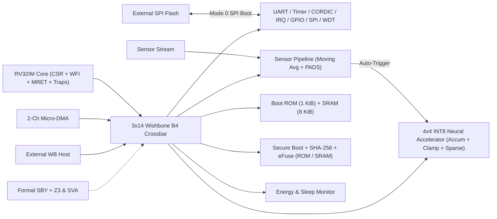

# ORX-1

## Edge-AI SoC Reference Design (RV32IM + INT8 Neural Accelerator + Formal Contracts)

ORX-1 is a compact, open SystemVerilog reference SoC for autonomous sensing and low-power TinyML inference at the edge. It integrates an **RV32IM** control core with machine-mode CSRs, traps, and `WFI` sleep, an autonomous sensor-to-NPU pipeline with predictive delta streaming, a 4x4 signed INT8 neural accelerator supporting multi-tile hardware accumulation, 2:4 structured sparsity, saturation clamp, and shadow weights, a multi-block SHA-256 / FNV-1a secure-boot engine capable of verifying up to `8 KiB` SRAM or `1 KiB` ROM images, an optional built-in SPI flash hardware bootloader, a 3-master x 14-slave Wishbone B4 crossbar, hardware Micro-DMA and CORDIC engines, four SymbiYosys + Z3 formal harnesses, and RTL activity counters for reproducible energy-proxy benchmarking.

The project passes strict zero-warning Verilator linting (`-Wall`), Yosys structural elaboration across both `orx1_soc` and `caravel_user_project_wrapper`, C host TinyML tests, 10 RTL simulations, and 4 Z3 formal checks. Physical tapeout signoff and calibrated silicon power measurements require running the downstream OpenLane 2 / PDK signoff flow.

> ORX-1 makes the control, autonomous sensing, neural inference, SPI/SHA-256 boot integrity, and formal verification boundaries explicit in a compact codebase with reproducible RTL and C benchmarks.

## Repository status

| Area | Current state | Scope of the reference implementation |
|---|---|---|
| Control core (`rv32i_core`) | Implemented | RV32IM ISA (`MUL`/`DIV`/`REM`), machine-mode CSRs (`mstatus`, `misa`, `mie`, `mtvec`, `mepc`, `mcause`, `mip`, `mhartid`, 64-bit `mcycle*`/`minstret*`), `WFI` sleep (`core_sleep`), `MRET`, external/timer IRQs, illegal-insn (`mcause=2`)/misaligned/bus/ecall/ebreak traps |
| On-chip memory (`boot_rom`, `sram_sp`) | Implemented | `1 KiB` boot ROM window (`0x00000000`–`0x000003FF`) with optional `BUILTIN_BOOTLOADER` or `BOOT_HEX` + `8 KiB` executable single-port SRAM (`0x00010000`–`0x00011FFF`) |
| Interconnect (`wb_interconnect`) | Implemented | 3-master (CPU, 2-ch Micro-DMA, external WB host) x 14-slave Wishbone B4 crossbar |
| Sensor pipeline (`sensor_pipeline`) | Implemented | Depth 1/2/4 moving average + Predictive Adaptive Delta-Stream (PADS) mode, low/high thresholds, and direct auto-inference trigger |
| Neural accelerator (`neural_accel`) | Implemented | 4x4 INT8 MAC array, hardware `cfg_accum`, bias add, shift, fused ReLU, INT8 clamp, 2:4 sparsity, shadow weight swap, threshold IRQ filter |
| Secure boot (`secure_boot`, `sha256_engine`) | Implemented | Multi-block SHA-256 and FNV-1a verification over boot ROM (`1..256` words) or SRAM (`1..2048` words), lockable 256-bit eFuse words, full digest readback (`0x18`), explicit `boot_release`/`fail` states |
| Peripherals | Implemented | 8-byte FIFO 8-N-1 UART, 64-bit `mtime`/`mtimecmp`, 2-ch Micro-DMA, 16-stage CORDIC, 6-source IRQ controller, 16-pin GPIO, SPI master, System Control / WDT (with WB host error flag) |
| Energy accounting (`energy_monitor`) | Implemented | Cycle, sensor, accelerator, data-bus, CPU performance, active/sleep cycle, and weighted activity counters |
| Formal checks (`formal/`) | Verified | 4 SymbiYosys + Z3 jobs (`cpu_bus.sby`, `wb_xbar.sby`, `neural_accel.sby`, `secure_boot.sby`) + SVA bind (`interface_sva.sv`) |
| Bare-metal C & TinyML SDK (`sw/`) | Implemented | HAL register definitions, tiled `cfg_accum`/`cfg_clamp` + 2:4 sparse API (`tinyml.c`), SPI flash bootloader (`bootloader.c`), host regression (`test_tinyml`), multi-layer benchmark (`bench_models`) |
| Physical implementation (`openlane/`) | Scaffolded | OpenLane configs targeting 50 MHz SkyWater 130nm (`sky130_fd_sc_hd`) and Caravel wrapper; post-layout DRC/LVS/GDS signoff requires OpenLane PDK execution |

## Architecture



1. **Zero-CPU Autonomous Sensing (`WFI` Wake-on-Anomaly)**: When enabled, [`rtl/sensor_pipeline.sv`](rtl/sensor_pipeline.sv) streams filtered samples directly into [`rtl/neural_accel.sv`](rtl/neural_accel.sv) while [`rtl/rv32i_core.sv`](rtl/rv32i_core.sv) sleeps in `WFI` (`core_sleep = 1`). With `cfg_thresh_irq` enabled, NPU inferences below `anomaly_thresh` complete silently without waking the CPU, raising `irq` only on threshold crossings.
2. **RV32IM & Synchronous Trap Architecture**: [`rtl/rv32i_core.sv`](rtl/rv32i_core.sv) executes out of both the `1 KiB` boot ROM and `8 KiB` SRAM (`orx1_pkg::in_range`), supporting RV32I + M (`MUL`/`MULH*` via shared 33x33 multiplier, 32-cycle `DIV*`/`REM*`), machine CSRs (`misa = 0x40001100`, `mhartid = 0`, 64-bit `mcycle*`/`minstret*`), and vectored trapping (`mcause = 0, 2, 3, 4, 5, 6, 7, 11` via `mtvec`, halting in `TRAP` only when `mtvec == 0`).
3. **Autonomous SPI Flash + SHA-256 Boot Provisioning**: Instantiating `orx1_soc #(.BUILTIN_BOOTLOADER(1'b1))` populates `boot_rom` with a 61-word hardware bootloader (matching [`sw/boot/bootloader.c`](sw/boot/bootloader.c)) that streams signed images (`"ORX1"` magic, length `1..2048` words, 256-bit expected SHA-256 digest) from external SPI flash into SRAM, locks the eFuse hash, runs [`rtl/secure_boot.sv`](rtl/secure_boot.sv) (`BOOT_CTRL = 0xA1`) over SRAM, and jumps to `0x00010000` only if `boot_release == 1` (halting cleanly on tamper without entering SRAM). When `BUILTIN_BOOTLOADER = 1'b0` (default), `BOOT_HEX` or external Wishbone host `m2` can load code directly.

## Memory map

| Slave | Region | Base address | Size | Function |
|---:|---|---:|---:|---|
| 0 | Boot ROM window | `0x00000000` | `0x400` | Read-only boot window (host-writable over WB Master 2; `BUILTIN_BOOTLOADER` or `BOOT_HEX`) |
| 1 | SRAM (`sram_sp`) | `0x00010000` | `0x2000` | `8 KiB` single-port data and executable instruction memory |
| 2 | Sensor pipeline | `0x40000000` | `0x100` | Sample inject, filter depth (`0..3` incl. PADS), thresholds, auto-infer enable |
| 3 | Neural accelerator | `0x40001000` | `0x100` | 4x4 INT8 operands, shift/bias/ReLU/clamp/accum/sparse/shadow/threshold CSRs |
| 4 | Secure boot | `0x40002000` | `0x100` | Multi-block SHA-256 / FNV-1a verification over ROM/SRAM (`0x18` exposes full 256-bit digest) and lockable eFuse words |
| 5 | UART core | `0x40003000` | `0x100` | Full-duplex 8-N-1 UART with 8-byte TX/RX FIFOs and IRQ masks |
| 6 | Energy monitor | `0x40004000` | `0x100` | Total/active/`WFI`-sleep cycles, CPU perf counters, and weighted activity proxy |
| 7 | System Timer | `0x40005000` | `0x100` | RISC-V 64-bit real-time counter (`mtime` / `mtimecmp`) |
| 8 | Micro-DMA | `0x40006000` | `0x100` | 2-channel autonomous DMA (`auto-restart`, `src_fixed`/`dst_fixed`) |
| 9 | CORDIC coprocessor | `0x40007000` | `0x100` | 16-stage vectoring magnitude and rotation engine |
| 10 | Interrupt controller | `0x40008000` | `0x100` | 6-source maskable peripheral IRQ aggregator (`sensor`, `accel`, `alert/gpio`, `uart`, `dma`, `cordic/spi`) |
| 11 | GPIO controller | `0x40009000` | `0x100` | 16-pin bidirectional GPIO with rising-edge interrupts |
| 12 | SPI master | `0x4000A000` | `0x100` | Configurable SPI Mode 0–3 master (`8`/`32`-bit transfers) |
| 13 | System control / WDT | `0x4000B000` | `0x100` | Host CPU boot-hold/boot-gate control, hardware watchdog timer, and sticky WB host error flag (`bit 3`) |

Complete register definitions and bitfields are documented in [`docs/register_map.md`](docs/register_map.md) and [`docs/bus.md`](docs/bus.md).

## Model & speed benchmarks

### Hardware RTL simulation (`tb/tb_model_bench.sv` @ 50 MHz)

[`tb/tb_model_bench.sv`](tb/tb_model_bench.sv) boots via a 2-word `boot_rom` trampoline into `0x00011000` SRAM (`276/1024` words), executes real quantized INT8 neural workloads and peripheral kernels on `orx1_soc`, checks outputs against golden references, and logs cycle, instruction, sleep, and `energy_monitor` counters (`MODEL_BENCH_PASS total_cycles=1856`, [`build/model_benchmark.csv`](build/model_benchmark.csv)):

| Workload | Cycles | Instr | CPI | Latency @ 50MHz | Throughput (`inf/s`) | MACs | MAC/cyc | MOPS @ 50MHz | Accel Events | Sleep Cyc | Wakeups | Weighted Energy |
|---|---:|---:|---:|---:|---:|---:|---:|---:|---:|---:|---:|---:|
| `cpu_mlp_4x4` | 302 | 207 | 1.46 | 6.04 us | 165,563 | 16 | 0.05 | 5.3 | 0 | 0 | 0 | 502 |
| `npu_mlp_4x4` | 103 | 46 | 2.24 | 2.06 us | 485,437 | 16 | 0.16 | 15.5 | 1 | 0 | 0 | 267 |
| `npu_mlp_8x4x4_x4` | 773 | 390 | 1.98 | 15.46 us | 64,683 | 192 | 0.25 | 24.8 | 12 | 0 | 0 | 1965 |
| `npu_sparse_2_4` | 102 | 45 | 2.27 | 2.04 us | 490,196 | 8 | 0.08 | 7.8 | 1 | 0 | 0 | 266 |
| `dma_burst_16w` | 125 | 72 | 1.74 | 2.50 us | 400,000 | — | 0.00 | 0.0 | 0 | 0 | 0 | 377 |
| `cordic_vec_mag` | 64 | 37 | 1.73 | 1.28 us | 781,250 | — | 0.00 | 0.0 | 0 | 0 | 0 | 148 |
| `auto_stream_wfi` | 187 | 42 | 4.45 | 3.74 us | 267,380 | 68 | 0.36 | 36.4 | 1 | 117 | 1 | 200 |

- **4x4 Dense INT8 Layer + ReLU + Clamp (`npu_mlp_4x4` vs `cpu_mlp_4x4`)**: **2.93x speedup** (`103` vs `302` cycles) and **1.88x lower weighted energy counter** (`267` vs `502`).
- **Multi-layer 2-Tile MLP (`npu_mlp_8x4x4_x4`)**: 4 samples of `8->4->4` (`192` MACs) using hardware `cfg_accum` achieve **24.8 MOPS** @ 50 MHz (`3.87 us/sample`) with bit-exact match against the testbench golden reference.
- **Autonomous Streaming (`auto_stream_wfi`)**: `rv32i_core` stays asleep in `WFI` for `117` cycles across `16` benign sensor pushes (`16'h0505`) with zero spurious wakeups and wakes once (`wake=1`, `accel=1`) when `16'h5050` crosses `anomaly_thresh = 100`.

### Host C TinyML SDK benchmark (`sw/tests/bench_models.c`)

[`sw/tests/bench_models.c`](sw/tests/bench_models.c) compiles [`sw/tinyml/tinyml.c`](sw/tinyml/tinyml.c) (using hardware `cfg_accum` multi-tile accumulation and hardware `cfg_clamp` saturation via `tinyml_dense_4x4_ex`) with `-O2 -Wall -Wextra -Werror -DORX1_HOST_TEST` against an exact register-level `orx1_host_reg` model of `neural_accel`, verifying bit-exact INT8 logits against a pure-C reference (`ref_dense`) ([`build/c_model_benchmark.csv`](build/c_model_benchmark.csv), `BENCH_MODELS_PASS`):

| Model | Inferences | MACs/Inf | NPU Calls | Host API Time | Host `inf/s` | Host MOPS | Pure-C `ref_t` | Logit Match | Argmax Match |
|---|---:|---:|---:|---:|---:|---:|---:|---:|---:|
| `mlp_8x4x4` | 1,600,000 | 48 | 4,800,000 | 0.511s | 3,131,115 | 300.6 | 0.009s | 64/64 | 16/16 |
| `mlp_16x8x4` | 800,000 | 160 | 8,000,000 | 0.740s | 1,081,081 | 345.9 | 0.040s | 64/64 | 16/16 |
| `sparse_2_4_16x4` | 1,600,000 | 32 | 6,400,000 | 0.490s | 3,265,306 | 209.0 | 0.010s | 64/64 | N/A |

*(Host C timings reflect running the `tinyml.c` HAL + register emulator on the host CPU and are complementary to the cycle-accurate RTL SoC table above.)*

## Verification strategy

ORX-1 is verified across static lint, synthesis elaboration, host C tests, 10 RTL simulations, and 4 Z3 formal checks:

- **C Host SDK & Bootloader**: `test_tinyml.c` (`SW_TINYML_TEST_PASS`), `bench_models.c` (`BENCH_MODELS_PASS`), and [`sw/boot/bootloader.c`](sw/boot/bootloader.c) (`-Wall -Wextra -Werror` clean build).
- **Strict Lint & Elaboration**: Zero warnings under `verilator --lint-only -Wall` (no `--Wno-fatal`) for both `orx1_soc` (20 modules) and `caravel_user_project_wrapper` (21 modules), plus `yosys` `proc; opt; check; stat` cleanly passing on `caravel_user_project_wrapper`.
- **RTL Simulation Suite (`iverilog -g2012` + `vvp`)**:
  - [`tb/tb_orx1.sv`](tb/tb_orx1.sv) (`ORX1_TEST_PASS`) — sensor & accelerator unit checks
  - [`tb/tb_secure_boot.sv`](tb/tb_secure_boot.sv) (`SECURE_BOOT_TEST_PASS`) — FNV-1a + single/multi-block SHA-256 + eFuse lock
  - [`tb/tb_soc.sv`](tb/tb_soc.sv) (`SOC_TEST_PASS`) — SoC integration & Wishbone routing
  - [`tb/tb_firmware.sv`](tb/tb_firmware.sv) (`FIRMWARE_TEST_PASS cycles=173`) — boot ROM execution
  - [`tb/tb_interrupts.sv`](tb/tb_interrupts.sv) (`INTERRUPT_TEST_PASS cycles=230`) — `WFI` + external/timer IRQ + `MRET`
  - [`tb/tb_peripherals.sv`](tb/tb_peripherals.sv) (`PERIPHERALS_TEST_PASS cycles=0`) — UART FIFO, GPIO, SPI, DMA, CORDIC, SYS_CTRL/WDT
  - [`tb/tb_boot_flash.sv`](tb/tb_boot_flash.sv) (`BOOT_FLASH_TEST_PASS cycles=1712`) — autonomous SPI flash SHA-256 SRAM boot, tamper rejection, and WB host error flag
  - [`tb/tb_cpu_benchmark.sv`](tb/tb_cpu_benchmark.sv) (`BENCHMARK_TEST_PASS`) — CPU microbenchmark
  - [`tb/tb_model_bench.sv`](tb/tb_model_bench.sv) (`MODEL_BENCH_PASS total_cycles=1856`) — TinyML/peripheral speed & energy suite
  - [`tb/tb_riscv_compliance.sv`](tb/tb_riscv_compliance.sv) (`RISCV_COMPLIANCE_PASS cycles=364 checks=43`) — full RV32IM, CSR, and trap compliance harness (`+HEX=`/`+SIG=` capable)
- **SymbiYosys Formal Proofs (`sby` + `z3`)**:
  - [`formal/cpu_bus.sby`](formal/cpu_bus.sby) (`prove`, depth 8) — CPU bus handshake stability, single-outstanding request rule, `TRAP`/`WFI` exclusivity, reset postconditions, and counter monotonicity under unconstrained stalls and `rsp_err`
  - [`formal/wb_xbar.sby`](formal/wb_xbar.sby) (`prove`, depth 10) — 3-master arbitration exclusivity, one-hot slave selection, and per-master starvation bounds
  - [`formal/neural_accel.sby`](formal/neural_accel.sby) (`prove`, depth 4) — single-cycle `irq`, single-cycle `busy -> done`, flag readback, and bounded INT8 clamp (`[-128, 127]`)
  - [`formal/secure_boot.sby`](formal/secure_boot.sby) (`bmc`, depth 24) — `boot_release`/`fail` exclusivity, SRAM read gating, and irreversible `efuse_lock`
  - Concurrent assertions remain in [`formal/interface_sva.sv`](formal/interface_sva.sv) / [`formal/orx1_bind.sv`](formal/orx1_bind.sv). See [`docs/verification.md`](docs/verification.md) and [`formal/README.md`](formal/README.md).

## Reproducible commands

### Unix / Bash (`Makefile`)

Requires `/bin/bash`, `gcc`, Icarus Verilog (`iverilog`/`vvp`), Verilator, Yosys, and SymbiYosys (`sby` + `z3`) on `PATH` (optional `riscv64-unknown-elf-gcc` for `make sw`). Generated logs and CSVs are written under `build/`.

| Command | Purpose |
|---|---|
| `make test-sw` | Run `test_tinyml`, `bench_models`, and compile-check `bootloader.c` |
| `make sim` | Run the 7 functional RTL regressions (including `tb_boot_flash`) |
| `make bench` | Run `tb_cpu_benchmark` and save `build/benchmark.log` |
| `make model-bench` | Run `tb_model_bench` and `bench_models`, saving `build/model_benchmark.{log,csv}` and `build/c_model_benchmark.{log,csv}` |
| `make compliance` | Run the 43-check RV32IM/CSR/trap compliance harness (`tb_riscv_compliance`) |
| `make sw` | Cross-compile bare-metal RV32IM example (`tinyml_anomaly_detector.{elf,hex}`) if `riscv64-unknown-elf-gcc` is installed |
| `make lint` | Run strict `verilator --lint-only -Wall` on `orx1_soc` and `caravel_user_project_wrapper` |
| `make synth` | Elaborate, optimize, check, and print resource stats for `caravel_user_project_wrapper` with Yosys |
| `make formal` | Run all 4 SymbiYosys Z3 formal harnesses (`wb_xbar`, `neural_accel`, `secure_boot`, `cpu_bus`) |
| `make all` | Execute `test-sw`, `sim`, `bench`, `model-bench`, `compliance`, `lint`, `synth`, and `formal` |
| `make clean` | Remove generated `build/` artifacts |
| `./scripts/run_sim.sh` | Run all 10 Icarus Verilog simulation testbenches directly |
| `./scripts/check_rtl.sh` | Run strict Verilator and Yosys validation across both tops directly |
| `./scripts/run_openlane.sh` | Invoke the OpenLane SkyWater 130nm physical flow |

### Windows PowerShell (`./scripts/verify_all.ps1`)

On Windows (without GNU `make` or `/bin/bash`), run the complete end-to-end verification pipeline (`COMMENT_CHECK`, `test_tinyml`, `bench_models`, `bootloader.c`, strict `verilator_bin.exe`, all 10 `iverilog`/`vvp` simulations, `yosys`, and all 4 `sby` Z3 proofs) with:

```powershell
./scripts/verify_all.ps1
```

## Open-source silicon ecosystem & TinyML SDK

### 1. Wishbone B4 interconnect & Caravel ASIC harness
* [`rtl/wb_interconnect.sv`](rtl/wb_interconnect.sv): 3-master (CPU, 2-channel Micro-DMA, external WB host), 14-slave Wishbone B4 crossbar with round-robin arbitration and priority host boot-load path.
* [`rtl/caravel_user_project_wrapper.sv`](rtl/caravel_user_project_wrapper.sv): Efabless Caravel padframe wrapper mapping ORX-1 to SkyWater 130nm (`sky130_fd_sc_hd`) user project pins, Wishbone slave port, GPIO, SPI, UART, and logic analyzer probes.

### 2. RISC-V architectural compliance
* [`tb/tb_riscv_compliance.sv`](tb/tb_riscv_compliance.sv): 43-check self-checking RV32IM, CSR, and trap harness supporting hex image loading (`+HEX=`), `tohost` handshakes, and signature dumps (`+SIG=`).
* [`sw/compliance/model_test.h`](sw/compliance/model_test.h): Official `riscv-arch-test` macro header.

### 3. Physical ASIC flow (OpenLane 2 / SkyWater 130nm)
* [`openlane/config.json`](openlane/config.json) & [`openlane/user_project_wrapper/config.json`](openlane/user_project_wrapper/config.json): OpenLane configurations targeting 50 MHz timing closure.
* [`openlane/pin_order.cfg`](openlane/pin_order.cfg) & [`openlane/constraints.sdc`](openlane/constraints.sdc): Caravel die pin order and Synopsys Design Constraints.

### 4. Bare-metal C, boot & TinyML runtime
* [`sw/include/orx1.h`](sw/include/orx1.h): Peripheral base addresses, CSR/register macros, CORDIC/UART/timer inline helpers, and `ORX1_HOST_TEST` hook.
* [`sw/tinyml/tinyml.h`](sw/tinyml/tinyml.h) & [`sw/tinyml/tinyml.c`](sw/tinyml/tinyml.c): Tiled quantized INT8 inference API (`tinyml_dense_4x4`, `tinyml_dense_4x4_ex`, `tinyml_sparse_2_4`, `tinyml_dense` using hardware `cfg_accum` and `cfg_clamp`) with hardware bias, shift, and ReLU.
* [`sw/boot/bootloader.c`](sw/boot/bootloader.c): SPI flash SHA-256 bootloader reference implementation.
* [`sw/examples/tinyml_anomaly_detector.c`](sw/examples/tinyml_anomaly_detector.c): Bare-metal streaming anomaly detector example.
* [`sw/tests/test_tinyml.c`](sw/tests/test_tinyml.c) & [`sw/tests/bench_models.c`](sw/tests/bench_models.c): Host C unit tests and multi-layer model throughput benchmarks.

## Continuous integration

[`.github/workflows/ci.yml`](.github/workflows/ci.yml) runs `make test-sw`, `make sim`, `make bench`, `make model-bench`, `make compliance`, `make lint`, `make synth`, and `make formal` on pushes and pull requests to `main`, uploading `build/` outputs as workflow artifacts.

## Scope & boundaries

- **Privilege & ISA subset**: `rv32i_core` implements machine-mode (`M`-mode) CSRs, `RV32IM`, `WFI`, and synchronous exception trapping (`mcause = 0, 2, 3, 4, 5, 6, 7, 11`), but omits Supervisor/User modes, MMU/PMP, caches, and `A`/`C`/`F` extensions.
- **Boot & OpenRAM initialization**: `BUILTIN_BOOTLOADER = 1'b1` boots and authenticates SRAM images up to `2048` words (`8 KiB`) from external Mode-0 SPI flash over `spi_master`; under `USE_OPENRAM` macros (`sram_sp`), port-1 reads are clocked synchronously whereas behavioral simulation reads SRAM combinationally (`imem_rdata = mem[imem_addr]`).
- **Energy proxy vs. silicon power**: `energy_monitor` accumulates weighted RTL activity events (`cycles`, active/sleep cycles, sensor, NPU, and bus events). Physical mW/uJ characterization and GDS DRC/LVS signoff require PDK-backed OpenLane 2 runs with technology liberty/LEF views.
- **Code style convention**: All SystemVerilog and C/H source files (`rtl/`, `tb/`, `formal/`, `sw/`) intentionally contain zero inline comments; architectural documentation lives in [`docs/`](docs/register_map.md).

## License

ORX-1 is distributed under the MIT License. See [`LICENSE`](LICENSE) for the full text.
