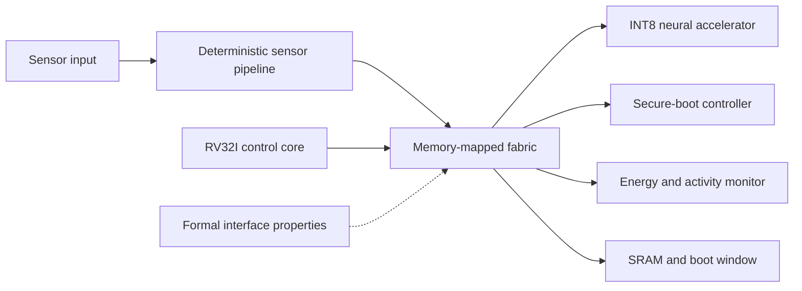

# ORX-1

## Formally Verified Edge-AI SoC Reference Design

ORX-1 is a compact, open SystemVerilog reference SoC for autonomous sensing at the edge. It combines a small RV32I-compatible control core, a deterministic sensor-processing path, a signed INT8 neural accelerator, a secure-boot control path, memory-mapped integration logic, formal interface properties, and an RTL-visible activity monitor for reproducible energy-proxy measurements.

The project is intentionally scoped as a portable reference architecture. It is suitable for simulation, linting, synthesis exploration, formal-property integration, and architectural extension. It is not a silicon implementation, a cryptographic product, or a measured power result.

> ORX-1 is designed to make the control, sensing, inference, integrity, and verification boundaries explicit in a small codebase that can be audited and extended.

## Repository status

The repository is ready to share as `ak495867/ORX-1`. The current implementation is a functional reference design with open-source simulation and synthesis checks. The primary regression covers the sensor pipeline and accelerator datapath. A secure-boot regression verifies that an incorrect image digest prevents boot release. Verilator linting and Yosys elaboration and structural checks are included in the normal workflow.

| Area | Current state | Scope of the reference implementation |
|---|---|---|
| Control core | Implemented | Compact RV32I-compatible subset with arithmetic, branches, jumps, loads, stores, and traps |
| Sensor pipeline | Implemented | Four-sample deterministic integer moving average with valid and interrupt pulses |
| Neural accelerator | Implemented | Four-term signed INT8 dot product with memory-mapped operands and one-cycle completion |
| Secure boot | Implemented | Deterministic rolling digest comparison with explicit release and fail states |
| Energy accounting | Implemented | Cycle, sensor, accelerator, bus, and weighted activity counters |
| Formal interface checks | Included | SVA properties and a bind module for request stability, bounded completion, and status exclusivity |
| Physical implementation | Not included | No technology-specific cells, floorplan, clock-tree, timing signoff, or tapeout claim |
| Cryptographic assurance | Not included | The digest path is an integration primitive and must be replaced by a reviewed cryptographic design |

## Architecture

The control core fetches 32-bit instructions through the boot window and accesses SRAM and peripherals through a simple request and ready data interface. The reference top level intentionally uses a zero-valued boot window so that the repository remains deterministic without relying on a vendor memory-initialization format. A derivative implementation can replace the window with an initialized ROM or a secure image-loading path.

The RV32I control model follows the architectural shape of the RISC-V base integer ISA: thirty-two 32-bit integer registers, a program counter, fixed-width base instructions, and a hardwired zero register. The implemented decoder is deliberately compact and treats unsupported or system instructions as traps. The normative RV32I specification describes the base register model, instruction formats, immediates, control transfer behavior, and arithmetic operations in detail [1].

The deterministic sensor pipeline accepts either the external top-level sensor stream or a memory-mapped injected sample. Four accepted samples produce one integer average. The neural accelerator stores four signed activations and four signed weights and returns a 32-bit signed dot product. Both blocks expose explicit event pulses that feed the activity monitor.

The secure-boot controller processes a fixed number of boot words with a deterministic rolling digest. The controller exposes separate `complete`, `boot_release`, and `fail` states. This separation is useful for integration and formal checks, but the mechanism is not a substitute for a production hash, signature verification, immutable root of trust, anti-rollback policy, or secure key provisioning.

## Memory map

| Region | Base | Size | Function |
|---|---:|---:|---|
| Boot window | `0x00000000` | `0x400` | Instruction and read-only reference window |
| SRAM | `0x00010000` | `0x1000` | On-chip data storage |
| Sensor pipeline | `0x40000000` | `0x100` | Sensor configuration and results |
| Neural accelerator | `0x40001000` | `0x100` | INT8 operand and control registers |
| Secure boot | `0x40002000` | `0x100` | Verification control and status |
| UART core | `0x40003000` | `0x100` | Full-duplex 8-N-1 serial transceiver |
| Energy monitor | `0x40004000` | `0x100` | Activity and energy-proxy counters |
| System Timer | `0x40005000` | `0x100` | RISC-V 64-bit real-time counter (mtime/mtimecmp) |
| Micro-DMA | `0x40006000` | `0x100` | 2-channel autonomous DMA memory engine |

The complete register-level description is available in [`docs/register_map.md`](docs/register_map.md).

## Verification strategy

ORX-1 uses layered verification. The leaf-level self-checking regressions exercise the moving-average pipeline, signed dot product, accelerator completion pulse, and secure-boot mismatch behavior. The formal directory contains concurrent properties and a bind module that can be connected to a simulator or formal engine with SystemVerilog Assertions support.

Assertions are used to express temporal behavior such as bounded request completion, stable request fields while a request is pending, mutually exclusive boot status, and a single-cycle accelerator interrupt. SystemVerilog supports immediate assertions, concurrent `assert property` statements, assumptions, and coverage constructs for dynamic and formal checking [2].

The repository does not claim proof completeness. The included properties are integration contracts that should be expanded with assumptions, coverage, reset analysis, protocol exhaustiveness, instruction-level compliance, and security-specific properties as the design matures.

## Reproducible commands

The repository assumes a Unix-like environment with Git, Icarus Verilog, Verilator, and Yosys available on `PATH`. Verilator’s user guide documents linting, model generation, simulation runtimes, coverage, and related workflows [3].

| Command | Purpose |
|---|---|
| `make sim` | Compile and run the primary and secure-boot regressions |
| `make bench` | Run the deterministic CPU benchmark and report cycle counters |
| `make lint` | Run Verilator lint on the SoC top level |
| `make synth` | Elaborate, optimize, check, and report the SoC with Yosys |
| `make formal` | Run the SymbiYosys CPU/bus proof with Z3 |
| `make all` | Run simulation, lint, and synthesis checks |
| `make clean` | Remove generated build outputs |
| `./scripts/run_sim.sh` | Run both simulation regressions directly |
| `./scripts/check_rtl.sh` | Run Verilator and Yosys validation directly |

Generated outputs are placed under `build/` and ignored by Git. The Makefile and scripts contain no tool-specific absolute paths, so the flow can be used locally or from continuous integration.

The repository also includes a `.devcontainer/` definition for a repeatable Ubuntu-based RTL toolchain. The CPU and SoC use an explicit request/response data interface with `req_valid`, `req_ready`, `req_write`, `req_addr`, `req_wdata`, `req_wstrb`, `rsp_valid`, `rsp_rdata`, and `rsp_err`. The core has `FETCH`, `MEM_REQUEST`, `MEM_WAIT`, and `TRAP` states so a derivative fabric can insert response latency.

## Continuous integration

The repository includes a GitHub Actions workflow that runs the simulation, lint, and synthesis targets on pushes and pull requests. The workflow is intended as a baseline gate. Projects derived from ORX-1 should add a pinned toolchain, a formal job, waveform artifact retention, coverage reporting, and a policy for simulator warning budgets.

## Limitations and next steps

The most important next step is to replace the zero-valued reference boot window with a real image-loading and verification path. A production secure-boot system should use a reviewed cryptographic implementation, an immutable trust anchor, authenticated metadata, key lifecycle controls, rollback protection, fault handling, and side-channel analysis.

The current control core is intentionally compact and is not presented as a complete privileged RISC-V implementation. It should be extended with precise exception behavior, CSRs, interrupt entry, memory ordering, compliance testing, and a documented software ABI before being used as a general-purpose processor.

The energy monitor counts RTL-visible events and applies fixed weights. It does not measure voltage, current, leakage, clock-tree power, memory macro power, or physical switching activity. Meaningful end-to-end energy estimates require a technology target, switching activity, clock definition, memory model, and calibrated power analysis flow.

## License

ORX-1 is distributed under the MIT License. See [`LICENSE`](LICENSE) for the full text.

## References

[1]: https://docs.riscv.org/reference/isa/v20260120/unpriv/rv32.html "RISC-V RV32I Base Integer Instruction Set"

[2]: https://www.doulos.com/knowhow/systemverilog/systemverilog-tutorials/systemverilog-assertions-tutorial/ "Doulos SystemVerilog Assertions Tutorial"

[3]: https://verilator.org/guide/latest/ "Verilator User’s Guide"
