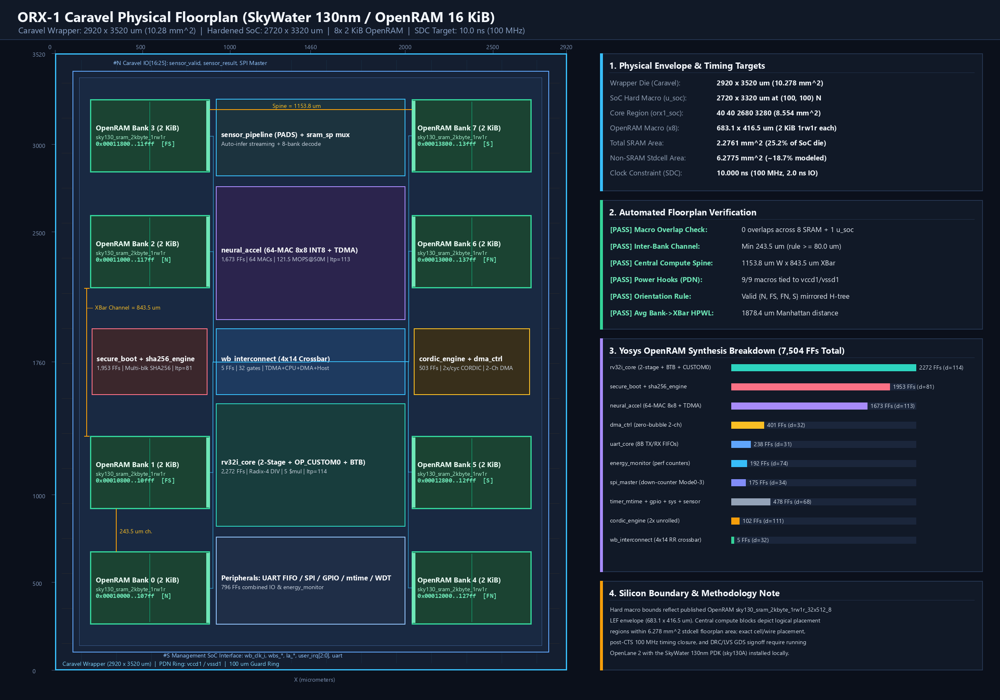

# ORX-1 Physical Floorplan & Caravel Integration (SkyWater 130nm / OpenRAM)

ORX-1 targets physical integration inside the Efabless **Caravel** user-project padframe (`2920 um x 3520 um`, `10.28 mm^2`) on SkyWater 130nm (`sky130_fd_sc_hd`), hardening [`orx1_soc`](../rtl/orx1_soc.sv) as a `2720 um x 3320 um` macro (`u_soc`) backed by eight `2 KiB` dual-port (`1rw1r`) OpenRAM macros (`16 KiB` total) at a `10.000 ns` (`100 MHz`) target clock constraint.

> **Scope & PDK Signoff Boundary:** `sky130A` PDK cells, OpenRAM `.lef`/`.lib`/`.gds` binaries, and OpenLane 2 are not installed in this local environment. Accordingly, hard macro bounds use the published OpenRAM `sky130_sram_2kbyte_1rw1r_32x512_8` LEF envelope (`683.1 um x 416.5 um`, `vccd1`/`vssd1` rails) and [`scripts/floorplan_analyze.py`](../scripts/floorplan_analyze.py) computes modeled standard-cell utilization from Yosys synthesis flip-flop/combinational counts. Post-CTS `100 MHz` STA timing closure, detailed routing congestion, and DRC/LVS GDS signoff require running [`./scripts/run_openlane.sh`](../scripts/run_openlane.sh) against an installed Sky130 PDK and OpenLane 2 toolchain.

## Hierarchical OpenLane Configuration

| Hierarchy Level | Top Module | Config File | Die Area (`um`) | Core Area (`um`) | Clock Constraint |
|---|---|---|---:|---:|---:|
| SoC Hard Macro | `orx1_soc` | [`openlane/config.json`](../openlane/config.json) | `0 0 2720 3320` (`9.0304 mm^2`) | `40 40 2680 3280` (`8.5536 mm^2`) | [`openlane/constraints.sdc`](../openlane/constraints.sdc) (`10.000 ns`, `2.000 ns` IO) |
| Caravel Wrapper | `caravel_user_project_wrapper` | [`openlane/user_project_wrapper/config.json`](../openlane/user_project_wrapper/config.json) | `0 0 2920 3520` (`10.2784 mm^2`) | `100 100 2820 3420` | [`openlane/user_project_wrapper/constraints.sdc`](../openlane/user_project_wrapper/constraints.sdc) (`10.000 ns`, `2.000 ns` IO) |

* **Top-Level Macro Placement ([`openlane/user_project_wrapper/macro.cfg`](../openlane/user_project_wrapper/macro.cfg)):** Places `u_soc` at `(100.0, 100.0) N`, leaving a symmetric `100.0 um` ring margin around the hardened core inside the Caravel wrapper (`2920 x 3520 um`).
* **Pin Orders:** [`openlane/pin_order.cfg`](../openlane/pin_order.cfg) places clock/reset/boot/core status North (`#N`), UART/IRQ/alert/SPI/GPIO South (`#S`), streaming sensor inputs East (`#E`), and processed sensor output + Wishbone host ports West (`#W`). [`openlane/user_project_wrapper/pin_order.cfg`](../openlane/user_project_wrapper/pin_order.cfg) aligns Caravel management Wishbone, logic analyzer, and `user_irq` South (`#S`) while distributing `io_in`/`io_out`/`io_oeb[0..37]` across West, North, and East.

## 8-Bank OpenRAM H-Tree Macro Layout

[`rtl/sram_sp.sv`](../rtl/sram_sp.sv) instantiates eight `sky130_sram_2kbyte_1rw1r_32x512_8` blackboxes (`u_sram.gen_sram_banks[0..7].u_bank`) under `-DUSE_OPENRAM`. [`openlane/macro.cfg`](../openlane/macro.cfg) arranges them in two mirrored columns flanking an unobstructed central compute spine:

| Instance | Address Range | Column | Origin (`um`) | Orient | Pin Facing |
|---|---|---|---:|---:|---|
| `u_sram.gen_sram_banks[0].u_bank` | `0x00010000..0x000107FF` | West | `(100.0, 160.0)` | `N` | Central spine (`+X`) |
| `u_sram.gen_sram_banks[1].u_bank` | `0x00010800..0x00010FFF` | West | `(100.0, 820.0)` | `FS` | Central spine (`+X`) |
| `u_sram.gen_sram_banks[2].u_bank` | `0x00011000..0x000117FF` | West | `(100.0, 2080.0)` | `N` | Central spine (`+X`) |
| `u_sram.gen_sram_banks[3].u_bank` | `0x00011800..0x00011FFF` | West | `(100.0, 2740.0)` | `FS` | Central spine (`+X`) |
| `u_sram.gen_sram_banks[4].u_bank` | `0x00012000..0x000127FF` | East | `(1936.9, 160.0)` | `FN` | Central spine (`-X`) |
| `u_sram.gen_sram_banks[5].u_bank` | `0x00012800..0x00012FFF` | East | `(1936.9, 820.0)` | `S` | Central spine (`-X`) |
| `u_sram.gen_sram_banks[6].u_bank` | `0x00013000..0x000137FF` | East | `(1936.9, 2080.0)` | `FN` | Central spine (`-X`) |
| `u_sram.gen_sram_banks[7].u_bank` | `0x00013800..0x00013FFF` | East | `(1936.9, 2740.0)` | `S` | Central spine (`-X`) |

### Automated Geometric & PDN Verification (`scripts/floorplan_analyze.py`)

Running `python3 scripts/floorplan_analyze.py --check-only` (`make floorplan`, included in `./scripts/verify_all.ps1` and CI) writes [`build/floorplan_metrics.json`](../build/floorplan_metrics.json) and asserts all physical checks (`FLOORPLAN_CHECK_PASS`):

* **Overlap & Grid Check:** `0` macro-to-macro or macro-to-boundary overlaps across all 8 SRAM banks + `u_soc`; all coordinates snapped to the `0.005 um` Sky130 manufacturing grid with valid `{N, FS, FN, S}` orientations.
* **Routing Channels:** Minimum intra-quadrant channel `243.5 um` (`>= 80.0 um` rule), central N–S compute spine `1153.8 um` wide, and central E–W crossbar belt `843.5 um` high (housing [`wb_interconnect`](../rtl/wb_interconnect.sv), [`secure_boot`](../rtl/secure_boot.sv), [`cordic_engine`](../rtl/cordic_engine.sv), and [`dma_ctrl`](../rtl/dma_ctrl.sv)). Mean SRAM-bank-to-crossbar Manhattan HPWL is `1878.4 um`.
* **Macro & Modeled Core Density:** Total OpenRAM area is `2.2761 mm^2` (`25.20%` of the `orx1_soc` die), leaving `6.2775 mm^2` of unobstructed stdcell core area (`~18.72%` conservative modeled stdcell utilization; `FP_CORE_UTIL: 42`, `PL_TARGET_DENSITY: 0.45`).
* **PDN Macro Hooks:** `9/9` explicit `FP_PDN_MACRO_HOOKS` bindings (`8` OpenRAM banks inside `orx1_soc` + `u_soc` inside `caravel_user_project_wrapper`) mapped to `vccd1` / `vssd1`.

## Yosys OpenRAM Synthesis Breakdown (`-DUSE_OPENRAM -DSYNTHESIS`)

Yosys elaboration + structural synthesis with `-DUSE_OPENRAM -DSYNTHESIS` reports **0 check problems**, **`8` OpenRAM blackbox instances**, **`71` `$mul` primitives**, and **`7,504` flip-flops** total across the SoC:

| Module | Flip-Flops | `$mul` Primitives | ABC Critical Path (`ltp -noff`) | Notes |
|---|---:|---:|---:|---|
| `rv32i_core` | 2,272 | 5 | 114 | 2-stage IF/EX, BTB (8 entries), Radix-4 DIV, `OP_CUSTOM0`, 32x32 regfile |
| `secure_boot` (incl. `sha256_engine`) | 1,953 | 1 | 81 | Multi-block SHA-256 (`1,064` FFs, `ltp=80`) + 256-bit eFuse + FNV-1a |
| `neural_accel` | 1,673 | 64 | 113 | 8x8 INT8 MAC array + Tensor-DMA + 4x4 shadow weights + 2:4 sparsity |
| `dma_ctrl` | 401 | 0 | 32 | Zero-bubble 2-channel round-robin DMA |
| `uart_core` | 238 | 0 | 31 | 8-byte TX/RX FIFOs, full-duplex 8-N-1 UART |
| `energy_monitor` | 192 | 0 | 74 | Weighted activity + CPU/sleep perf counters |
| `spi_master` | 175 | 0 | 34 | Mode 0–3, 8/32-bit transfers |
| `timer_mtime` | 128 | 0 | 64 | 64-bit `mtime` / `mtimecmp` |
| `gpio_ctrl` | 112 | 0 | 10 | 16-pin bidirectional GPIO + edge IRQs |
| `cordic_engine` | 102 | 1 | 111 | 2x/cycle unrolled 16-step CORDIC + scale multiply |
| `orx1_soc` top glue | 102 | 0 | 12 | `imem_addr_q`, `boot_imem_q`, sensor/CSR glue |
| `sys_ctrl` | 70 | 0 | 68 | WDT + boot hold/gate + WB host error flag |
| `sensor_pipeline` | 68 | 0 | 55 | Moving average (1/2/4) + PADS + thresholds |
| `sram_sp` | 7 | 0 | 10 | 8-bank OpenRAM mux (`+ 8` `sky130_sram_2kbyte_1rw1r_32x512_8` blackboxes) |
| `irq_ctrl` | 6 | 0 | 7 | 6-source maskable IRQ controller |
| `wb_interconnect` | 5 | 0 | 32 | 4-master x 14-slave round-robin Wishbone B4 crossbar |
